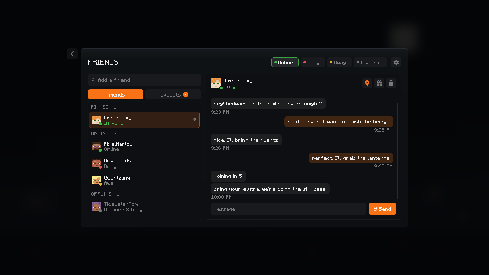

# Flint Client

**A fast, modern launcher and in-game client for Minecraft: Java Edition.**

[Website](https://flintclient.com) · [Download](https://github.com/IconicDemon/Flint-Client/releases/latest) · [Discord](https://discord.gg/59rAHZMWb7) · [Changelog](https://flintclient.com/releases/)



Flint Client signs you in with your Microsoft account, installs Minecraft and Fabric for you, and keeps every version you
play in its own tidy profile. Inside the game, Flint adds its own menu, HUD and quality-of-life mods, Flint Friends and
cosmetics, on every version it supports.

## Download

| Platform | File |
|---|---|
| Windows 10 / 11 (64-bit) | [FlintClient-Setup.exe](https://github.com/IconicDemon/Flint-Client/releases/latest/download/FlintClient-Setup.exe) |
| macOS, Apple silicon (M1 and newer) | [FlintClient-AppleSilicon.dmg](https://github.com/IconicDemon/Flint-Client/releases/latest/download/FlintClient-AppleSilicon.dmg) |
| macOS, Intel | [FlintClient-Intel.dmg](https://github.com/IconicDemon/Flint-Client/releases/latest/download/FlintClient-Intel.dmg) |
| Linux, most distributions | [FlintClient.AppImage](https://github.com/IconicDemon/Flint-Client/releases/latest/download/FlintClient.AppImage) |
| Linux, Debian and Ubuntu | [FlintClient.deb](https://github.com/IconicDemon/Flint-Client/releases/latest/download/FlintClient.deb) |

Each release lists the SHA-256 of every file in `SHA256SUMS.txt`. Flint updates itself: when a new version is out, an
**Update** button appears in the top bar, and every update's signature is checked before it installs.

- **Windows:** the installer isn't code-signed yet, so SmartScreen may ask first: choose **More info**, then **Run anyway**.
- **macOS:** the app isn't notarized by Apple yet. The first time, open **System Settings → Privacy & Security** and choose
  **Open Anyway** for Flint Client.
- **Linux:** make the AppImage executable (`chmod +x FlintClient.AppImage`) and run it, or install the `.deb`.

## Features

**Launcher**
- Microsoft sign-in, with several Minecraft accounts side by side; sign-ins stay in your system's keychain.
- One profile per version, with its own mods, resource packs, shader packs, worlds and memory.
- Mods, resource packs and shader packs from Modrinth in a few clicks. Resource and shader packs can be added while you
  play and show up in the game straight away.
- Imports profiles from other launchers.
- Skins and capes with a live 3D preview, including animated capes.
- Flint Store cosmetics, Flint Friends and the news, all in one place.

**In game**
- The Right Shift menu: Flint's mods, HUD modules and settings, with a drag-and-drop HUD editor.
- Armor HUD, keystrokes, CPS, FPS, coordinates, zoom, freelook, custom fog, nametags and many more quality-of-life mods.
- Flint Friends and messages, and Flint cosmetics that other Flint players see on you.
- Performance tuning that keeps the game smooth, on every supported version.

**Supported Minecraft versions:** 26.3, 26.2, 26.1.x, 1.21.11, 1.21.10, 1.21.1 and 1.8.9.

## Repository

```text
app/            The desktop launcher (Tauri 2: a Rust core and a React interface)
game-runtime/   The Fabric runtime that runs inside Minecraft (modern versions, plus legacy189/ for 1.8.9)
docs/           Architecture, multi-version support, the update system and the release process
```

## Building from source

See [BUILDING.md](BUILDING.md). In short: Java 25, Node 22 and Rust stable, then

```sh
cd game-runtime && ./gradlew build
cd ../app && npm ci && npm run tauri dev
```

Builds made from this repository run without Flint's hosted services: Flint Friends, the Flint Store and Flint AI need
a configured backend.

## Contributing and security

- [CONTRIBUTING.md](CONTRIBUTING.md): how to report bugs and propose changes.
- [SECURITY.md](SECURITY.md): how to report a vulnerability privately.

## Licence

Flint Client's source code is free software under the [GNU General Public License v3.0](LICENSE) (GPL-3.0-only).
Third-party components and their licences are listed in [THIRD_PARTY_NOTICES.md](THIRD_PARTY_NOTICES.md).

## Trademarks

"Flint Client", the Flint name and the Flint logo are the project's trademarks. The GPL covers the code, not the name
or logo: a modified or redistributed version must use its own name and logo and must not suggest it is Flint Client or
endorsed by it.

Flint Client is not affiliated with Mojang or Microsoft. Minecraft is a trademark of Mojang Synergies AB; you need to
own Minecraft: Java Edition to play. This repository contains no Minecraft game files: the launcher downloads them from
Mojang for players who own the game. The version wallpapers in this repository are original placeholders.
